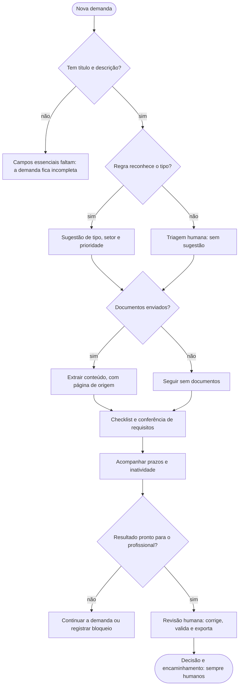
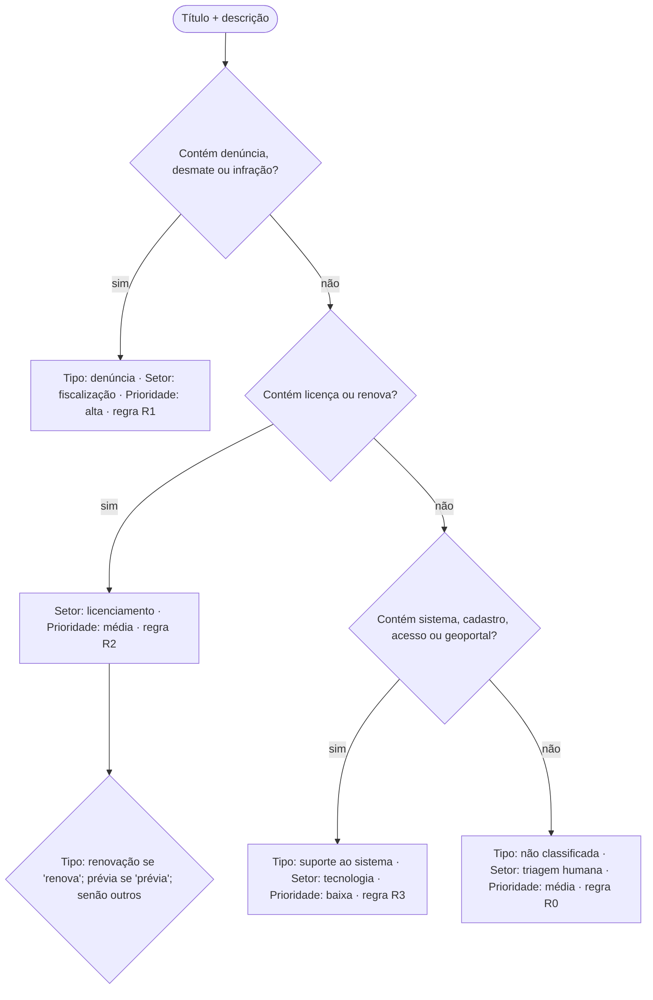
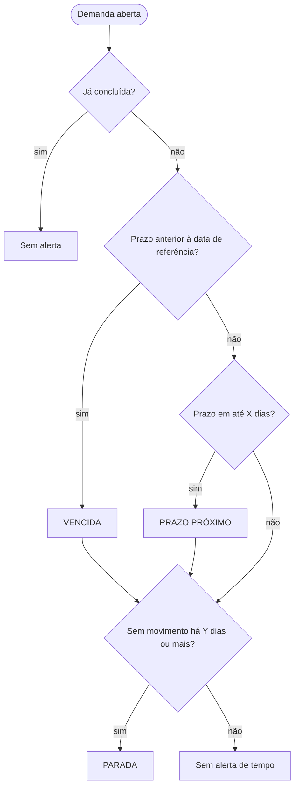
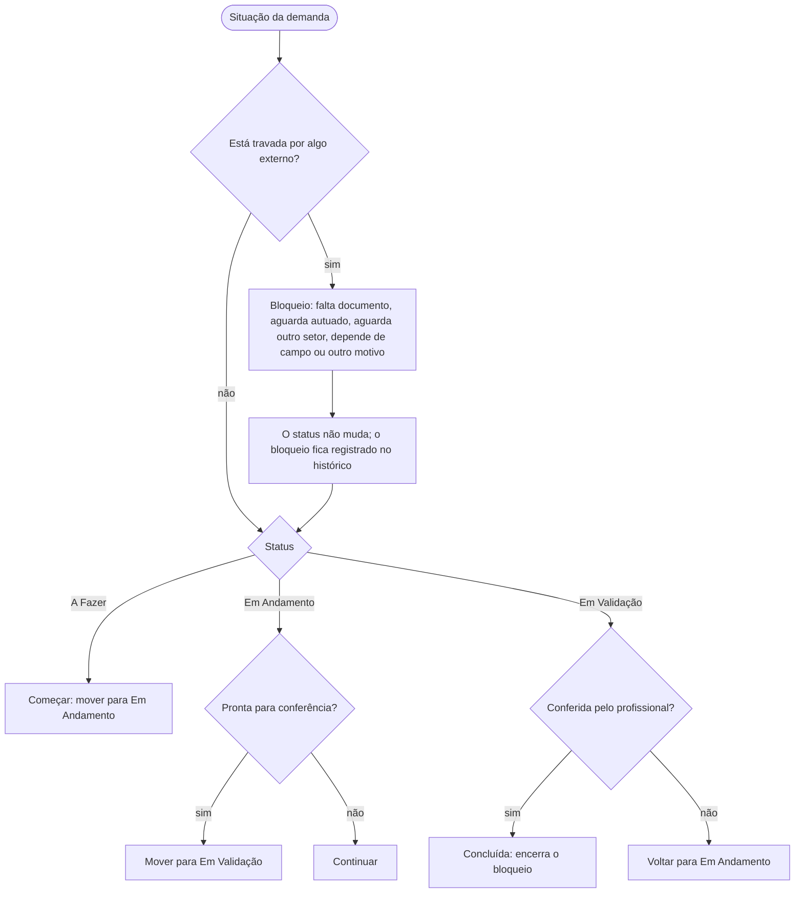
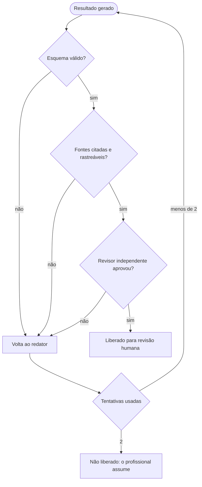
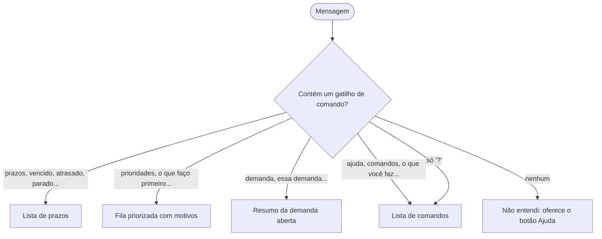

# Árvore de decisão do GUARÁ

Como o GUARÁ decide o que fazer com uma demanda, o que apenas sugere e onde a decisão é sempre humana. Serve de guia para quem usa o sistema e para quem mantém o código.

> **Princípio:** o GUARÁ classifica, sinaliza e rascunha. Decisões, aprovações, assinaturas e encaminhamentos oficiais são sempre do profissional (planejamento, seção 3).

## Legenda

| Marca | Significado |
|---|---|
| **Implementado** | Existe no código e tem teste no repositório. |
| **Planejado** | Está no planejamento, mas ainda não existe como código de produção (por exemplo, o orquestrador). |

## 1. Visão geral

## 2. Triagem: tipo, setor e prioridade

A triagem sugere, não decide. Hoje há duas camadas.

**Implementado (aplicação, tela Demandas):** o tipo `campo` ou `gabinete` e a natureza `demanda` ou `comum` são deduzidos das palavras do título (`aplicacao/src/modulos/demandas/classificacao.ts`).

**Implementado (habilidade `classificar-demanda`, com autoteste):** regras por palavras-chave, na ordem abaixo. A primeira que casar vence.

| Regra | Condição (palavras) | Setor | Prioridade | Observação |
|---|---|---|---|---|
| R1 | denúncia, desmate, infração | fiscalização | alta | Vem primeiro: uma denúncia que cite licença cai aqui. |
| R2 | licença, renova | licenciamento | média | Tipo: renovação-licença, licença-prévia ou licenciamento-outros. |
| R3 | sistema, cadastro, acesso, geoportal | tecnologia | baixa | |
| R0 | nenhuma acima | triagem humana | média | Sem regra aplicável, o profissional decide. |

Em toda classificação, a saída traz a regra aplicada e a marca de **sugestão**. Se a sugestão estiver errada, corrija à mão; não há correção automática.

## 3. Quando a demanda está parada ou com prazo

Três sinais, calculados a partir da data de referência. Eles avisam; não mudam o status.

| Sinal | Regra | Valor padrão |
|---|---|---|
| Vencida | prazo < data de referência | — |
| Prazo próximo | prazo em até X dias | **Implementado:** 3 dias úteis no assistente (`assistente/avisos.ts`) |
| Parada | sem ação relevante há Y dias ou mais | **Implementado:** 3 dias em Alertas (`alertas/dados-portaveis.ts`), ajustável |

Concluir a demanda encerra o bloqueio e a tira da lista de paradas.

### 3.1 Priorização (assistente): módulo e comando "prioridades"

O módulo `aplicacao/src/modulos/assistente/priorizar.ts` calcula uma pontuação para cada demanda aberta, com pesos fixos e públicos (`PESOS`). Ele não altera demandas, não grava e não usa IA: só devolve uma lista ordenada. O comando "prioridades" do assistente lista até 5 demandas com o motivo e os pontos (inferência) e a próxima ação da primeira (sugestão). O painel também mostra a **fila do dia** (as 3 primeiras, com "por que está aqui" e a sugestão), acima das notificações. Os avisos de 3 agora juntam os sinais: uma demanda vencida e parada gera um aviso só, do tipo mais urgente, com os dois sinais no texto. Um sinal novo faz o "Ciente" anterior deixar de valer.

Cada demanda que pede atenção recebe:

- **Pontuação:** a soma dos sinais ativos.
- **Motivos:** um por sinal, cada um com seus pontos e a marca **fato** (dado gravado) ou **inferência** (cálculo por regra).
- **Próxima ação sugerida:** vem de uma tabela de decisão determinística. É sempre sugestão.

| Sinal | Unidade | Marca |
|---|---|---|
| Vencida | dias úteis de atraso (conta até 10) | inferência |
| Prazo próximo | dias úteis que faltam (até 3) | inferência |
| Vistoria próxima | dias úteis (até 2), só com data marcada | fato |
| Parada | dias corridos (mais de N, padrão 3; conta até 10) | inferência |
| Travada | dias úteis desde o bloqueio, com o motivo | fato |
| Sem prazo | — | fato |
| Campos faltando | — | fato |
| Prioridade (alta, média, baixa) | — | fato |

- **Prioridade:** só soma quando já existe outro sinal. Uma demanda de prioridade alta e sem nenhum problema não entra na fila. "Sem prazo" conta como sinal e, sozinho, já coloca a demanda na fila.
- **Empate:** vence o prazo mais próximo (sem prazo por último) e, depois, o código da demanda.
- **Concluídas** ficam sempre fora.
- **Sigilo:** o detalhe digitado no bloqueio **não** aparece no resultado. Só a categoria (por exemplo, "falta documento").

| Situação | Próxima ação sugerida |
|---|---|
| Vencida e travada | Cobrar o retorno, citando o motivo do bloqueio |
| Vencida | Decidir: prorrogar o prazo ou concluir |
| Vistoria próxima | Preparar a vistoria |
| Travada | Cobrar o retorno, citando o motivo do bloqueio |
| Parada, em andamento | Registrar a última ação ou travar com o motivo |
| Parada, em validação | Concluir a validação ou devolver |
| Parada, a fazer | Começar ou travar com o motivo |
| Prazo próximo | Planejar a entrega antes do prazo |
| Sem prazo | Definir o prazo (sugestão: 10 dias úteis) |
| Campos faltando | Preencher os campos que faltam |

A linha que casa primeiro vence. A decisão continua humana: o GUARÁ sugere, o profissional decide.

## 4. Status e bloqueio

Os quatro status são **A Fazer → Em Andamento → Em Validação → Concluída** (`aplicacao/src/modulos/demandas/modelo.ts`).

- **Bloqueio** é uma marca separada do status. Mudar o motivo não muda o momento em que a demanda travou.
- Toda mudança fica no **histórico**, que só cresce: não se edita nem se apaga evento.

## 5. Quando o resultado vai ao profissional

Esta é a regra do gate de qualidade (planejamento, seção 9.4). **Planejado**, ainda sem orquestrador em produção.

- No máximo **duas tentativas** de correção. Depois disso, o resultado não é liberado e a demanda segue com o profissional.
- O revisor **nunca revisa o próprio trabalho** e **não pode ser desativado** no fluxo de resultados.

## 6. Assistente (painel de conversa)

O assistente responde por regras, sem IA paga (`aplicacao/src/modulos/assistente/classificar.ts`). A frase é normalizada e comparada com os gatilhos da tabela `frases.ts`.

Para ensinar um sinônimo, acrescente um gatilho em `frases.ts`. Para um comando novo, acrescente uma intenção: ela aparece sozinha na ajuda.

## 7. Onde a decisão é humana

| Momento | Quem decide |
|---|---|
| Aceitar ou corrigir a sugestão de tipo, setor e prioridade | Profissional |
| Tratar uma demanda sem regra (R0) | Profissional |
| Mudar prioridade, prazo ou responsável | Profissional |
| Concluir uma demanda | Profissional |
| Liberar um resultado ao usuário final | Profissional, após revisão |
| Assinar, aprovar ou encaminhar oficialmente | Profissional, sempre |

## Limites

- As regras são de palavras-chave: uma frase fora do vocabulário cai em R0 ou em "não entendi". É esperado e seguro.
- Os dados são fictícios no MVP (`dados-ficticios/`). Dados reais dependem de classificação e autorização institucional.
- O orquestrador (`backend/supabase/functions/orquestrador/`) ainda não está implementado. Os fluxos descritos nas seções 5 e 9.4 do planejamento são o alvo, não o que roda hoje.

## Referências

- Planejamento, seções 3, 5 e 9.4: `planejamento/planejamento_estagiario_digital_fofofauna.md`
- Regras de triagem: `backend/supabase/functions/_compartilhado/habilidades/classificar-demanda/implementacao.ts`
- Prazos: `backend/supabase/functions/_compartilhado/habilidades/avaliar-prazos/implementacao.ts`
- Status e bloqueio: `aplicacao/src/modulos/demandas/modelo.ts` e `regras.ts`
- Assistente: `aplicacao/src/modulos/assistente/README.md`
